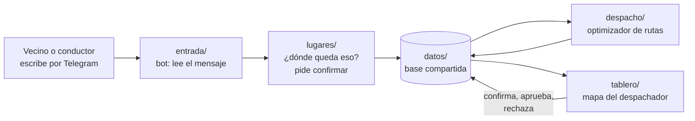

# DespachoX

Equipo 19 · Hackathon UNAL Manizales 2026 · Vertical 04, Logística y abastecimiento.
Samuel Rosso (líder) · Carlos Orrego · Jacobo Vasco · Nicolás Ramírez · José Manuel Aristizábal

> **Si acabas de llegar:** primero lee [`docs/PROBLEMA.md`](docs/PROBLEMA.md), que explica qué problema resolvemos. Luego esta página, que explica cómo lo resolvemos. Después abre tu archivo de tareas: [`SAMUEL.md`](SAMUEL.md), [`JACOBO.md`](JACOBO.md) o [`CARLOS.md`](CARLOS.md).

## Qué es, en un párrafo

Después del sismo, a Manizales llegó comida donada. Lo difícil fue decidir a dónde mandarla primero, por cuál vía y antes de que se dañara. DespachoX es una mesa de despacho para la persona que toma esa decisión en un centro de acopio. Los barrios piden por chat, los conductores avisan por chat cuando una vía está cerrada, el sistema propone rutas para los vehículos disponibles y las vuelve a calcular cuando algo cambia. La persona que despacha aprueba o rechaza cada plan.

La regla que no se negocia: **el modelo de lenguaje lee y ordena los mensajes; el optimizador y las reglas calculan; el despachador decide.**

## Cómo funciona

Un ejemplo de punta a punta:

1. Un líder de barrio escribe: «somos 40 familias en san jose no hay arroz ni leche».
2. El bot lo convierte en un pedido (lugar, familias, productos, urgencia) y contesta: «Ubiqué "san jose" en: San José (barrio). ¿Es correcto?».
3. La persona dice que sí. El pedido aparece en el mapa del despachador.
4. El despachador lo confirma y pulsa «Calcular plan». Aparecen las rutas de cada vehículo.
5. Un conductor escribe: «derrumbe en la avenida del centro, no pasa camión». El despachador confirma el cierre.
6. El sistema recalcula: el camión ya no entra a San José y el pedido pasa a un campero. La pantalla dice qué cambió.
7. El despachador aprueba con su nombre. Queda registrado.

## Qué hay en cada carpeta

| Carpeta | Qué hace | En palabras simples | Dueño |
|---|---|---|---|
| `entrada/` | Bot de Telegram | Recibe mensajes, usa un modelo de lenguaje para sacar los datos, borra teléfonos y nombres, y guarda el pedido o el cierre | Samuel |
| `lugares/` | Ubicador de lugares | Convierte «por la siria» en un punto del mapa. Conoce 452 nombres y apodos de Manizales. Si no sabe, lo dice y pide la ubicación. Nada se ubica sin que una persona confirme | Carlos |
| `despacho/` | Optimizador | Reparte los pedidos entre camiones, camperos y motos sobre el mapa real de vías, saca primero lo que vence primero y recalcula cuando se cierra una vía | Carlos |
| `despacho/sim/` | Simulación | Prueba el sistema en 360 jornadas inventadas y lo compara contra otras formas de despachar | Carlos |
| `tablero/` | Pantalla del despachador | Mapa con pedidos, cierres y rutas; botones para confirmar, calcular, aprobar y rechazar; bitácora de decisiones | Jacobo |
| `datos/` | Base de datos | `esquema.sql` define las tablas. `semilla/` trae datos de prueba inventados: 15 puntos, 2 acopios, 5 vehículos, 20 pedidos | Carlos |
| `docs/` | Documentos | Estrategia, ficha, guiones, resultados (ver más abajo) | Samuel |
| `pitch/` | Presentación | Guion del pitch | Samuel |
| `despliegue/` | Nube | Lo necesario para correr todo en Railway | Carlos |
| `torre/`, `encargos/` | Coordinación con Claude | Bitácoras de las sesiones de Claude Code y las instrucciones que se les dieron | Carlos |

Los módulos no se llaman entre sí: solo se comunican por la base de datos. Por eso se pudieron construir en paralelo.

## Estado al viernes 3:30 p. m.

| Pieza | Estado |
|---|---|
| Bot | Funciona con claves reales. Leyó bien 62 de 64 datos en 15 mensajes de ejemplo escritos por el equipo. **Falta probarlo con mensajes de una persona desde un teléfono** |
| Ubicador de lugares | Funciona. En 44 frases de prueba: 30 aciertos directos, 5 ofreciendo opciones, 9 «no sé» y ningún lugar equivocado propuesto con seguridad |
| Optimizador | Funciona. Planea 17 pedidos en unos 10 segundos y recalcula ante cierres |
| Tablero | Funciona. Un fallo conocido: con un plan ya aprobado, «Calcular plan» borra las rutas anteriores. En corrección |
| Simulación | Primera ronda completa, segunda en curso |
| Todo junto con un teléfono real | **Pendiente.** Es el siguiente paso |
| En la nube | **En curso** (Carlos) |
| Trazabilidad de paquetes | Pendiente |
| Ficha de los seis componentes | **Vacía** (`docs/FICHA.md`). Hay borrador de los componentes 4 a 6 |
| Cifras verificadas por una persona | **Ninguna** (`docs/FUENTES.md` vacío) |
| Aliado con nombre | Ninguno |

Las pruebas automáticas pasan completas: 101.

### Qué dice la simulación, sin adornos

- Contra despachar por orden de llegada, DespachoX sube las entregas a tiempo en puntos críticos entre 12 y 46 puntos porcentuales, según la carga.
- Contra un despachador experto que ya prioriza lo urgente, **empata** en puntos críticos, queda unos 2 puntos por debajo en el total de entregas a tiempo y ahorra entre 47 y 75 km por jornada.
- El desperdicio de perecederos baja a cero por una regla de bodega (sacar primero lo que vence primero), no por el ruteo.

El argumento honesto: DespachoX pone al alcance de cualquier voluntario lo que hoy solo sabe hacer un despachador con experiencia, lo combina con los cierres que llegan por chat y deja registro. Detalle en `docs/SIMULACION.md`.

## Cómo se construyó

Casi todo el código lo escribieron sesiones de Claude Code dirigidas por Carlos, cada una con un encargo escrito (`encargos/`) y una bitácora (`torre/`). Se coordinaron entre sí por `torre/CANAL.md`. **Por eso es normal que no lo entiendas todavía.** Tu primera tarea incluye entender tu parte, porque mañana el jurado te va a preguntar por ella.

Una forma rápida: abre Claude en esta carpeta y escribe «explícame `entrada/` (o `tablero/`) como si mañana me fueran a preguntar por él, y hazme cinco preguntas difíciles».

## Cómo probarlo

**En la nube (cuando Carlos termine el despliegue):** le escribes al bot en Telegram y abres el tablero en la dirección que Carlos ponga aquí.

- Bot: [t.me/despachox_bot](https://t.me/despachox_bot) (o escanea el código de abajo)
- Tablero: _por definir_

**En tu computador:** `docs/GUIA_SIGUIENTE.md`, «Paso 0». Ojo: solo un proceso puede leer el bot con el mismo token. Si el bot corre en la nube, no lo arranques en local.

**El guion de la demo**, con los mensajes y clics exactos: `docs/GUION_DEMO.md`.

## Qué nos califican

| # | Criterio | Puntos | Dónde lo trabajamos |
|---|---|---|---|
| 1 | Problema y vertical | 20 | `docs/FICHA.md`, `docs/FUENTES.md` |
| 2 | Prototipo de solución | 25 | El código, la demo y `docs/SIMULACION.md` |
| 3 | Conocimiento utilizado | 15 | `docs/investigacion/06_patentes_sipi.md` |
| 4 | Plan de 30 a 90 días | 15 | `docs/FICHA_4_5_6_BORRADOR.md` |
| 5 | Viabilidad y aliados | 15 | `docs/FICHA_4_5_6_BORRADOR.md` |
| 6 | Impactos esperados | 10 | `docs/FICHA_4_5_6_BORRADOR.md`, `docs/SIMULACION.md` |

El código cubre sobre todo el criterio 2. Los otros 75 puntos se ganan escribiendo, verificando y hablando con gente.

## Fechas

| Cuándo | Qué |
|---|---|
| Hoy, 5:00 o 7:00 p. m. | Mentoría 1: se muestran los componentes 1 a 3 |
| Sábado 8:30 a. m. | Se congelan las funciones: desde ahí solo se arregla |
| Sábado 10:30 a. m. | Mentoría 2: los seis componentes y la presentación |
| Sábado 1:00 a 2:30 p. m. | Entrega: un enlace de Google Drive registrado en iNNOVO |
| Sábado 2:30 p. m. | Pitch de preselección |
| Sábado 4:00 p. m. | Presentaciones finales |

## Mapa de documentos

| Si quieres saber… | Lee |
|---|---|
| Cuál es el problema que resolvemos | `docs/PROBLEMA.md` |
| Qué me toca ahora | `SAMUEL.md`, `JACOBO.md`, `CARLOS.md` |
| Por qué construimos esto y cómo ganar | `docs/ESTRATEGIA.md`, `docs/PLAN_EQUIPO.md` |
| Qué existe ya en el mundo y qué nos diferencia | `docs/ESTADO_DEL_ARTE.md` |
| Cómo se hace la demo | `docs/GUION_DEMO.md` |
| Qué decir en el pitch y qué van a preguntar | `pitch/GUION.md` |
| Dónde podemos perder | `docs/SUGERENCIAS.md` |
| Cómo se entrega y los horarios oficiales | `docs/PLATAFORMA_INNOVO.md` |
| Qué patente UNAL usamos | `docs/investigacion/06_patentes_sipi.md` |
| Cómo correr todo en la nube | `docs/DESPLIEGUE.md` |

## Reglas del equipo

- Ninguna clave en el repositorio. Van en `.env` o en las variables de Railway.
- Ningún dato personal real. Los datos de prueba son inventados.
- Toda cifra del pitch lleva su fuente en `docs/FUENTES.md`, y alguien del equipo abrió el enlace.
- Los números de la simulación se presentan como simulación.
- Cuando termines una tarea, márcala en tu archivo y haz `git pull --rebase && git push`.

Datos del mapa: © colaboradores de OpenStreetMap.
