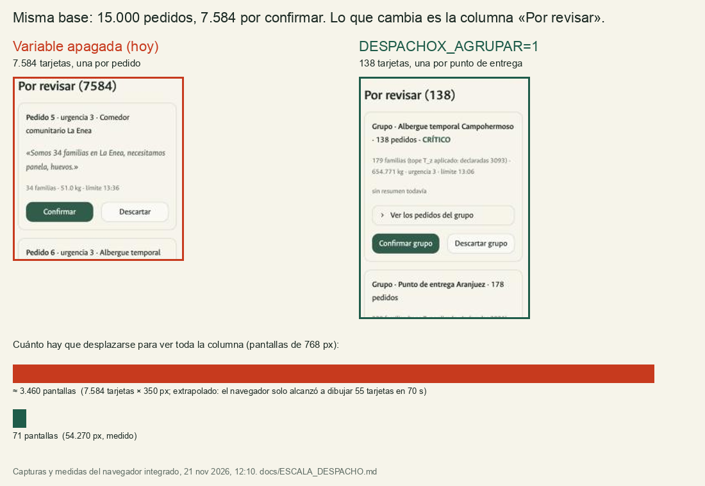

# ¿Qué pasa en la mesa con 15.000 pedidos?

Medición del sábado 21 de noviembre de 2026, entre las 11:50 y las 12:05, rama `escala`. Responde al encargo `encargos/S3_MUCHOS_PEDIDOS.md`. Suma al criterio 2 (prototipo que funciona con carga) y al 5 (viabilidad). `entrada/ESCALA.md` ya mostró que el bot recibe 15.000 mensajes sin perder ninguno; aquí se mide lo que pasa después: el tablero y el optimizador.

**Qué es medido y qué es supuesto.** Todas las cifras son **medidas por nosotros [M]** con `despacho/escala.py` en este computador, sobre una base temporal. La máquina es un Apple M5 con 24 GB de memoria, macOS 25.5, Python 3.12.13, OR-Tools y Streamlit 1.67 del `.venv` del proyecto. Nada corrió en Railway. No se llamó a la API de Anthropic ni a Telegram. Los pedidos son sintéticos, sin datos de nadie.

## Cómo se armó la base

- La semilla completa (`despacho/semilla.py`): 2 acopios, 5 vehículos (2 camiones de 3.000 y 2.000 kg, 2 camperos de 600 kg y una moto de 40 kg, 6.240 kg en total) y 34 lotes.
- Un punto de entrega por cada barrio y vereda de `datos/semilla/barrios.csv`: 138 puntos, 13 de ellos críticos (el 10 %, sorteado con semilla fija; **supuesto**).
- Pedidos sintéticos con semilla 2026: barrio sorteado con pesos exponenciales (unos barrios piden mucho más que otros), de 3 a 40 familias, de 1 a 3 productos no perecederos y a veces uno perecedero, kilos por familia de la semilla, urgencia 3 en los puntos críticos y 1 a 3 en el resto, llegados en las últimas 3 horas y con límite de 4, 10 o 20 horas según urgencia.
- Para medir el **tablero**, la mitad de los pedidos quedan `nuevo` (7.584) y la otra mitad `confirmado` (7.416).
- Para medir el **optimizador**, todos quedan `confirmado` y los lotes se multiplican para que el inventario no sea el cuello de botella (demanda × 1,3). Así se mide el ruteo con la flota de la semilla, no la bodega.

## Parte 1 · El tablero con 15.000 pedidos

### Las consultas de `tablero/datos.py` (mediana de 3 corridas)

| Consulta | Pestaña | Segundos |
|---|---|---:|
| `por_revisar` | Mesa | 5,87 |
| `territorio` | Territorio | 0,06 |
| `informe` | Informe | 0,06 |
| `indicadores` | Mesa | 0,004 |
| `plan_vigente`, `rutas`, `sin_atender`, `cierres_sin_aplicar`, `bitacora` | Mesa, Plan, Bitácora | menos de 0,001 cada una |

Casi todo el tiempo se va en `por_revisar`: por cada pedido nuevo hace una consulta aparte para buscar sus repetidos (`duplicado_de`), así que con 7.584 pedidos nuevos son 7.584 consultas. Las demás lecturas aguantan la carga sin problema.

### Pintar la página con `streamlit.testing.v1.AppTest`

`st.tabs` pinta las cinco pestañas en la misma corrida, así que se mide el total y, por aparte, lo que se fue en cada función de datos (envueltas con un cronómetro).

| | Con 15.000 pedidos |
|---|---:|
| Corrida completa de `tablero/app.py` | 13,2 s |
| De ellos, en funciones de datos | 6,5 s (`por_revisar` 6,1; `territorio` 0,3; `informe` 0,1) |
| De ellos, en pintar | 6,7 s |
| Elementos en pantalla | 15.191 bloques de texto y 15.170 botones |
| Memoria del proceso | de 191 a 666 MB |
| Error | ninguno |

Lo que se pinta es la columna «Por revisar» de la pestaña Mesa: una tarjeta con dos botones por cada uno de los 7.584 pedidos nuevos. Nadie puede revisar eso a mano, y el navegador recibe 15.000 botones. Las pestañas Territorio, Informe y Bitácora quedan por debajo de medio segundo cada una. El mapa, que pone un círculo por pedido, entra dentro de los 6,7 s de pintar; no se separó.

**Lo que no se midió.** El tiempo en el navegador real (AppTest no abre uno, así que no mide cuánto tarda Chrome en dibujar 15.000 botones ni el mapa con 15.000 círculos). El refresco automático cada 5 segundos: con una corrida de 13 s, el fragmento se dispara antes de terminar; no se midió qué pasa en ese caso.

## Parte 1 · El optimizador por tamaño, como está hoy

`planificar` con el límite de búsqueda de hoy (8 s), la flota de la semilla y el grafo regional. Una corrida por tamaño.

| Pedidos confirmados | Segundos totales | De ellos, matrices | Atendidos | Críticos a tiempo | Sin atender | Kilos planeados | Demanda (kg) |
|---:|---:|---:|---:|---:|---:|---:|---:|
| 50 | 8,4 | 0,2 | 48 | 7 de 7 | 2 | 2.922 | 3.544 |
| 100 | 8,3 | 0,3 | 89 | 12 de 12 | 11 | 5.527 | 7.002 |
| 250 | 8,5 | 0,5 | 106 | 22 de 24 | 144 | 6.232 | 17.441 |
| 500 | 8,7 | 0,6 | 100 | 42 de 56 | 400 | 6.222 | 35.557 |
| 1.000 | 9,0 | 0,6 | 91 | 44 de 60 | 909 | 6.134 | 72.913 |

Lectura:

- **Siempre termina**, en 8,3 a 9,0 s. El límite del solver se respeta y el resto (leer, matrices, escribir) suma menos de un segundo hasta 1.000 pedidos. La memoria máxima del proceso fue 327 MB.
- **Lo que manda es la flota, no el solver.** Desde 250 pedidos los kilos planeados se quedan en unos 6.200 kg, la capacidad de los cinco vehículos en un viaje. Lo que no cabe queda listado en el plan como «no cabe en la flota disponible», que es lo que hoy ve el despachador. Con 1.000 pedidos, 909 quedan por fuera.
- **La calidad baja con el tamaño.** Con 8 s fijos, el solver atiende 106 pedidos de 250 pero solo 91 de 1.000: tiene más nodos que explorar en el mismo tiempo. Los críticos a tiempo pasan de 22 de 24 a 44 de 60.
- Los 2 «sin inventario» de 50 pedidos son productos con frío que solo están en un acopio; no es un error.
- **No se midió `planificar` con 15.000 pedidos sueltos.** Con 1.000 pedidos el modelo ya tiene 1.000 nodos; con 15.000, la tabla de tiempos por tipo de vehículo sería de 15.000 × 15.000 × 3 enteros en listas de Python, unos 20 GB. No se intentó.

## Parte 2 · Agrupar por punto de entrega y planear sobre grupos

### Qué se agregó

- `despacho/agrupar.py`: regla determinista. ST-DBSCAN del triage (`triage/cluster.py`, 250 m y 6 h, `min_samples` 2) sobre el punto y la hora de cada pedido, partido por punto de entrega, con familias y kilos sumados y **recortados al tope de la zona** `T_z` de `triage/censo.py` (población sintética de la semilla, afectación a priori 0,10). Urgencia máxima, límite más cercano, pedido más antiguo como representante. Sin modelo.
- `planificar` con `DESPACHOX_AGRUPAR=1` (o `--agrupar`): los confirmados entran como un pedido por grupo; la parada lleva el id del pedido más antiguo y los kilos del grupo; `resumen.grupos` dice qué pedidos forman cada grupo; al aprobar, todos los miembros pasan a `asignado`. Apagada, nada cambia (prueba `despacho/tests/test_agrupar_plan.py`).

### Qué salió con 15.000 pedidos confirmados

| | Medido |
|---|---:|
| Tiempo de agrupar 15.000 pedidos | 0,13 s |
| Grupos | 138, uno por punto |
| Pedidos del grupo más grande | 674 |
| Familias declaradas → con tope | 321.506 → 35.518 |
| Kilos declarados → con tope | 1.116.994 → 123.877 |
| Grupos recortados por el tope | 127 de 138 |
| Kilos del grupo: menor, mediana, mayor | 136, 856, 1.791 |

Los 15.000 pedidos salen en **138 grupos, uno por punto**, porque ST-DBSCAN encadena en el tiempo: si un punto recibe pedidos cada rato, las 3 horas caen en un solo grupo. Es el comportamiento del algoritmo del triage; una ventana cerrada (bloques de 6 h) sería otra regla y hay que decidirla. El tope por zona hace lo que pedía el encargo: 674 mensajes del mismo barrio no se vuelven 674 mercados, y la demanda baja de 1.117 a 124 toneladas. Ese número depende de la población sintética y de la afectación supuesta.

### El plan sobre grupos, por tamaño

| Pedidos | Grupos | Segundos totales | Grupos atendidos | Pedidos cubiertos* | Críticos a tiempo (grupos) | Sin atender | Kilos planeados |
|---:|---:|---:|---:|---:|---:|---:|---:|
| 50 | 37 | 8,4 | 36 | 49 | 6 de 6 | 1 | 2.922 |
| 100 | 54 | 8,3 | 48 | 94 | 5 de 5 | 6 | 5.527 |
| 250 | 88 | 8,5 | 40 | — | 6 de 6 | 48 | 6.232 |
| 500 | 108 | 8,6 | 32 | — | 8 de 10 | 76 | 6.222 |
| 1.000 | 124 | 8,7 | 26 | — | 10 de 11 | 98 | 6.221 |
| **15.000** | **138** | **8,9** | **8** | — | **4 de 5** | **130** | **4.376** |

\* Pedidos dentro de los grupos atendidos; solo se sumaron para 50 y 100. Para los demás tamaños no se calculó.

Lectura:

- **15.000 pedidos recibidos se convierten en 138 cosas que una persona puede mirar, y el plan sale en 8,9 s**, igual que con 50. Esa es la cifra del encargo. Memoria máxima: 363 MB.
- **La flota sigue siendo el techo.** Hasta 1.000 pedidos los kilos planeados son los mismos que sin agrupar (unos 6.200 kg): agrupar no inventa vehículos. Con 15.000 bajan a 4.376 kg porque la mediana de un grupo (856 kg) ya no cabe en un campero de 600 kg y hay puntos a los que el camión no llega. El plan lo dice: «no cabe en ningún vehículo que llegue al punto». En la realidad eso se resuelve con varios viajes o partiendo el grupo, y hoy el modelo planea un viaje por vehículo.
- **Los críticos van primero.** Sobre grupos, de 250 a 15.000 pedidos los grupos críticos a tiempo quedan entre 6 de 6 y 10 de 11, frente a 22 de 24 y 44 de 60 sin agrupar. Un grupo crítico atendido cubre a todos sus pedidos, así que por pedido la cobertura de críticos sube, pero no la medimos pedido a pedido más allá de 100.
- Con 50 y 100 pedidos, agrupar casi no cambia nada: 49 de 50 y 94 de 100 pedidos quedan dentro de un grupo atendido, frente a 48 y 89 sueltos.

## Parte 3 · El resumen del modelo y la vista

- `despacho/resumen_grupo.py`: arma el texto de entrada (cabecera con familias y kilos sumados por código, y los textos de los pedidos pasados por `entrada/privacidad.limpiar`, hasta 60) y guarda el resumen en la tabla nueva `resumenes_grupo`. El extractor se inyecta; en las pruebas es falso. **No se llamó al modelo real en esta sesión** y nadie llama todavía a `resumir_y_guardar` en producción: el tablero muestra «sin resumen todavía».
- Tablero: con `DESPACHOX_AGRUPAR=1`, «Por revisar» muestra una tarjeta por grupo de pedidos nuevos con familias (y el tope si recortó), kilos, urgencia, el resumen marcado «leído por el modelo», «Ver los pedidos del grupo» y los botones «Confirmar grupo» y «Descartar grupo», que confirman o descartan pedido por pedido con bitácora. Los pedidos agrupados no se repiten sueltos. Apagada, la columna es la de hoy.

### El tablero con la vista de grupos encendida (12:02, misma base de 15.000)

| | Variable apagada | `DESPACHOX_AGRUPAR=1` |
|---|---:|---:|
| Corrida completa de `tablero/app.py` | 13,2 s | 9,9 s |
| `por_revisar` | 6,1 s | 5,6 s |
| `grupos_por_revisar` (agrupar 7.584 pedidos nuevos) | — | 0,07 s |
| Pintar | 6,7 s | 4,0 s |
| Botones en pantalla | 15.170 | 278 (138 grupos) |
| Memoria del proceso al final | 666 MB | 522 MB |

Agrupar cuesta 0,07 s y deja 138 tarjetas en vez de 7.584. Lo que queda de los 9,9 s son dos cosas que la vista de grupos no toca: `por_revisar`, que la mesa sigue llamando con su consulta por pedido (5,6 s), y el mapa, que sigue poniendo un círculo por cada uno de los 15.000 pedidos (dentro de los 4,0 s de pintar). Las dos están en la lista de abajo.

### Después de arreglar `por_revisar` (12:30, misma base)

`por_revisar` ahora lee los repetidos de todos los pedidos nuevos en una sola consulta (`JOIN` sobre `duplicado_de`) en vez de una por pedido. Las 61 pruebas del tablero siguen pasando.

| | Apagada | `DESPACHOX_AGRUPAR=1` |
|---|---:|---:|
| `por_revisar` | 5,6 s → **0,02 s** | 5,6 s → **0,02 s** |
| Corrida completa de `tablero/app.py` | 13,2 s → **6,5 s** | 9,9 s → **4,4 s** |
| De ellos, en funciones de datos | 0,4 s | 0,3 s |
| De ellos, en pintar | 6,2 s | 4,1 s |
| Memoria del proceso al final | 667 MB | 522 MB |

Lo que queda es pintar: 15.170 botones sin grupos, y en los dos casos el mapa con un círculo por cada uno de los 15.000 pedidos.

### Las dos versiones en el navegador (12:08)

Capturas del tablero en el navegador integrado de la sesión, con la misma base de 15.000 pedidos. Sin grupos, el navegador tardó unos 30 segundos en pasar del esqueleto a la página, porque recibe 7.584 tarjetas con dos botones cada una y la página se vuelve a calcular cada 5 segundos. Con grupos, la página apareció en menos de 10 segundos.

En la primera pantalla las dos versiones se parecen: mismos indicadores, mismo mapa, y solo cambia el número de «Por revisar». La diferencia es el largo de esa columna. Medido en el navegador con grupos: 138 tarjetas ocupan 54.270 px, 71 pantallas de 768 px. Sin grupos, a unos 350 px por tarjeta, 7.584 tarjetas serían unas 3.460 pantallas (**extrapolado**: el navegador solo alcanzó a dibujar 55 tarjetas en 70 s, porque la mesa se recalcula cada 5 s y nunca termina de pintar).



Capturas completas: `capturas/escala_15000_sin_grupos.jpg` y `capturas/escala_15000_con_grupos.jpg`.

## Qué haría falta

1. ~~En `por_revisar`, leer los repetidos en una sola consulta~~ Hecho a las 12:30: de 5,6 a 0,02 s.
2. Con la variable encendida la mesa ya muestra grupos (278 botones en vez de 15.170); falta que el mapa dibuje por punto y no por pedido.
3. Permitir que un grupo salga en varios viajes o se parta por capacidad del vehículo. Hoy un grupo de 856 kg en un punto al que solo llega el campero no sale.
4. Decidir la ventana de tiempo del grupo: encadenada (como ahora) o en bloques.
5. Conectar `resumir_y_guardar` a un proceso que corra con el modelo real y medir su costo.

## Para repetirlo

```bash
.venv/bin/python -m despacho.escala --tablero --pedidos 15000
.venv/bin/python -m despacho.escala --tablero --pedidos 15000 --agrupar
.venv/bin/python -m despacho.escala --planificar 50 100 250 500 1000
.venv/bin/python -m despacho.escala --planificar 50 100 250 500 1000 15000 --agrupar
.venv/bin/python -m pytest despacho/tests/test_agrupar.py despacho/tests/test_agrupar_plan.py despacho/tests/test_resumen_grupo.py tablero/tests/test_grupos.py -q
```
